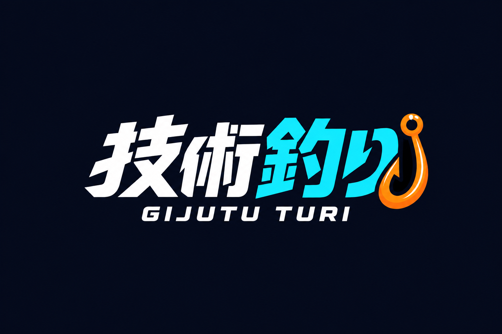
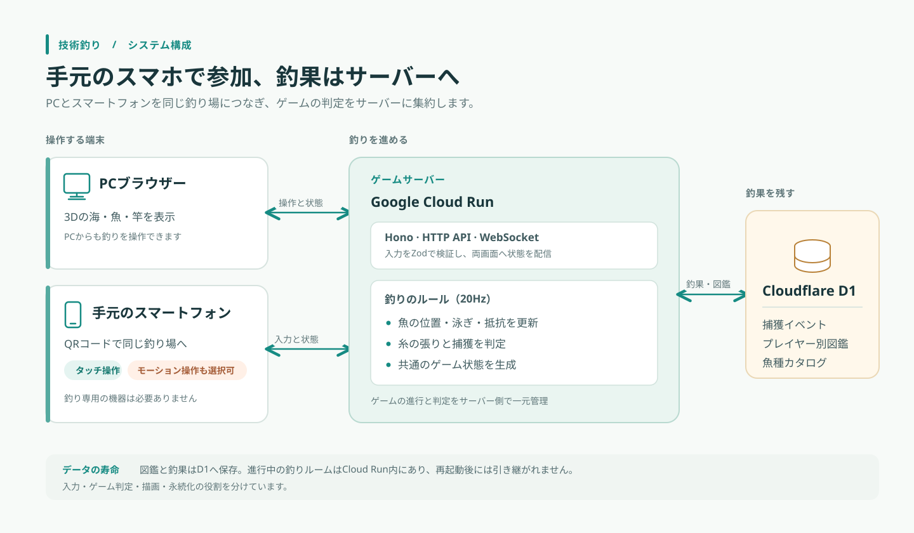

# JOGIHACK 2026 評価シート

## 参加者

**わかと（個人参加）**

## 公開URL

- [技術釣り](https://gijutu-turi-e7ranic5ja-an.a.run.app/)
- [魚と技術の一覧展示](https://gijutu-turi-e7ranic5ja-an.a.run.app/complete)

## この作品で届けたいこと

**魚の反応を見ながら、スマートフォンで気軽にリールを巻いて釣る。**

釣りの面白さは、アタリを待ち、魚を掛けた後に引きを見ながら巻く・待つを選ぶ駆け引きにあります。本作では、PCに映る海と魚を見ながら、手元のスマートフォンでその駆け引きを楽しめます。QRコードで釣り場につなぎ、タッチ操作ですぐ始められます。釣り専用機器は不要で、対応端末ではモーション操作も選べます。

### 魚ごとの泳ぎと個性

| 魚 | 魚の動き・見た目 |
| --- | --- |
| Go魚 | 警戒して向きを変えた後に突進し、横へ泳ぐ。群れは演出で、抵抗と捕獲判定は主魚1匹が担う |
| Dockerクジラ | 背中にコンテナを載せた大きな魚。重い初動とゆっくりした旋回の後、強く突進する |
| CSS fish | 魚体の形を保ちながら、ファイトの状態に応じて色や模様が変わる |
| K8sレヴィアタン | 本体の後を二つの影が追い、突進に合わせて隊形を変える。影は演出で、釣果は本体だけを数える |
| Rustカジキ | 長い吻と青い縦縞を持ち、速い突進を繰り返して水面へ跳ね上がる |
| JSアナゴ | 胴全体を波打たせて泳ぎ、ファイトでは周期的な突進やコイル状の動きを見せる |

同じ操作でも魚によって泳ぎや抵抗が変わり、魚の反応を見て巻く・待つを切り替えます。技術の違いは、泳ぎと駆け引きを釣り比べるための比喩として表しています。

### 竿・糸・海の表現

竿は穂先へ細くなる竿身に握り・リール・ガイドを組み、魚の張力や引く向きに応じて滑らかにしなります。糸は竿のガイドを通り、水面を境に空中と水中の見え方が切り替わります。海には重なった波、魚やウキの波紋、空の反射と日差しのきらめきを描きました。魚の動きや糸の張りと画面表現が連動し、静かな釣り場の中でも駆け引きが伝わるようにしています。釣具や水の物理を完全再現するのではなく、ゲームの状態を見せる表現です。

## 体験を支える仕組み

- スマートフォンをQRコードで接続し、タッチや対応端末のモーションを釣り操作に使います。
- 操作イベントをサーバーで検証し、固定周期のゲーム更新へ適用します。サーバーが魚の動き・抵抗・捕獲を判定し、WebSocketでPCとスマートフォンへ同じ状態を届けます。
- HTTP API、WebSocketルーム、ゲーム規則、図鑑保存の役割を分けています。釣果はCloudflare D1へ保存し、同じ捕獲イベントの再送で二重に数えないようにしています。

## デモの流れ

1. PCで[技術釣り](https://gijutu-turi-e7ranic5ja-an.a.run.app/)を開き、「スマホを接続」からQRコードを読み取ります。
2. スマートフォンでタッチ操作を始めます。対応端末ではモーション操作も選べます。
3. アタリに合わせて魚を掛け、泳ぎと糸の張りを見ながら巻く・待つを切り替えます。釣り上げた後は図鑑で魚を見比べられます。

## 評価観点への対応

- **技術の相当性:** スマートフォン入力、魚ごとの反応、3D表現、釣果保存を一つの釣り体験につなげています。
- **設計の妥当性:** クライアントは入力と描画、サーバーは釣りの判定、D1は釣果記録を担います。
- **技術的な挑戦:** モーション入力、魚種別のファイト、竿・糸・海面の表現を二画面で同期します。
- **完成度:** PCだけでも遊べ、スマートフォンはタッチ操作から始められます。モーションが使えない端末でも釣りを続けられます。
- **面白さ・独自性:** 魚の泳ぎと引きを通じて、技術ごとの個性を釣り比べられます。

## 確認事項

モーション操作は端末の姿勢を竿の角度へそのまま写すのではなく、釣りの局面に合わせた操作へ変換します。審査端末でのモーション操作は未確認のため、タッチ操作を基本のデモ手順としています。図鑑の釣果記録はD1に保存されますが、進行中の釣りはCloud Runのプロセス内にあり、サーバー再起動後には続きません。
